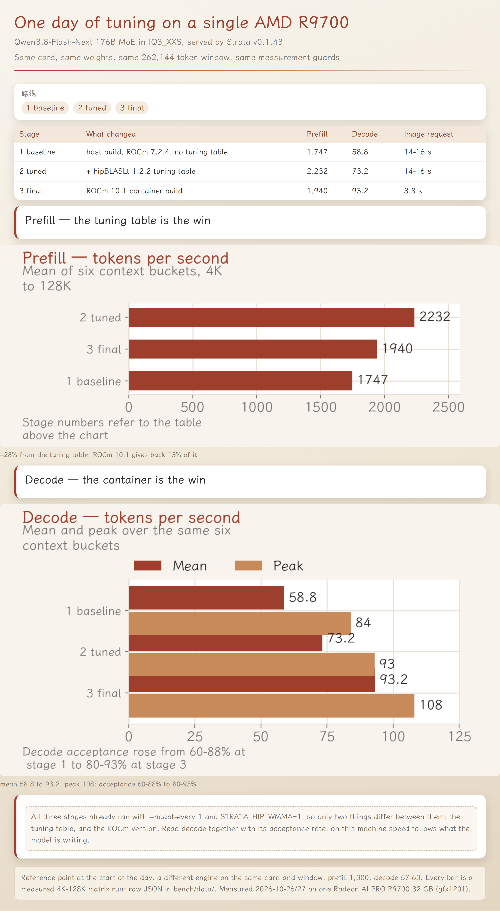

# 单卡 AMD R9700（RDNA4 / gfx1201）上的 Strata 176B MoE

[English](README.md) | 中文

一整天的实测记录、容器构建方法、两个补丁，以及真正有效的调参 —— 在**一张 32 GB
Radeon AI PRO R9700** 上跑 **Qwen3.8-Flash-Next 176B MoE 的 IQ3_XXS 量化**，服务进程是
**ROCm 10.1 容器里的 Strata v0.1.43**。

这不是一个"炫耀跑分"的仓库。它是一套可复现的配置、解释性能天花板在哪里的算术，以及一份诚实
清单：我们花时间试过、但**没有用**的开关。在你为某个参数再熬一晚之前，先读
[试过且否决的开关](docs/DEAD-ENDS.md)。

下面每个数字都是这台机器的实测。每张表格都由 [`bench/data/`](bench/data) 里的原始 JSON 生成。

---

## 一天的总览



图上三段是**同一张卡上的同一个引擎**。三段都已经开了 `--adapt-every 1` 和 `STRATA_HIP_WMMA=1`，
所以它们之间只有两件事不同：hipBLASLt 调优表，以及 ROCm 版本。调优表赢的是 prefill，ROCm 10.1
容器赢的是 decode。作为参照：当天早上用另一个引擎、同一张卡同一窗口，是 prefill 1,300、decode 57–63。

---

## 结果

最终状态（ROCm 10.1 容器、`--spec 4`、`--adapt-every 1`、`sampling.temperature 0.3`、
262,144 窗口、1K 输出、防缓存污染措施全程开启，见 [docs/METHODOLOGY.md](docs/METHODOLOGY.md)）：

| 指标 | 实测 |
|---|---|
| decode | **稳定 95–99 tok/s**（接受率 86–92%），峰值 **108** |
| prefill | 16–64K 上下文 **1,900–2,100 tok/s**，128K **1,800**，230K **1,534** |
| 上下文窗口 | 配置 **262,144**；约 256K 的 prompt 会被**直接拒绝（HTTP 400）**，实用上限约 240–245K |
| 识图 | HIP 图像编码器 **3.8 s/张**（CPU 编码器 14–16 s） |
| 跨对话缓存 | RAM **12 槽 / 12 GiB**（2026-10-27 由 8 槽 / 6 GiB 上调）：冷启 4.1 s → **热态 0.54 s**，8/8 命中是在 8 槽那档测的 |
| session 存 / 取 | 237 MB 存 **2.6 s**、取回 **0.4 s**，容器重启后仍在。快照现在是 **2.28 GB**（见 [FINDINGS 第 6 节](docs/FINDINGS.md)） |
| 冷启动到可出首 token | **85 s** |

对比当天早上的起点（同一张卡、同一窗口、另一个引擎）：prefill 1,300 → **1,900–2,230**，
decode 57–63 → **95–99**。

---

## 决定这台机器速度的两件事

**1. 是 PCIe 链路，不是显卡算力。** 宿主平台是 PCIe 3.0（Cascade Lake），卡的上游端口
`LnkSta: 8GT/s (downgraded)`，所以 R9700 实际跑在 **Gen3 x16**。实测 host↔GPU 带宽
**13.8 GB/s**，1 流 / 2 流 / 4 流并发完全一样 —— 这是链路硬顶，不是调度问题。任何"每个 decode
步都要把模型状态搬过 PCIe"的设计都会被这个数字卡死。详见 [docs/HARDWARE.md](docs/HARDWARE.md)。

**2. 是投机解码的接受率，不是上下文长度。** `--spec 4` 时每步产出 = `1 + 4 × 接受率`。这台机器
上接受率在 **55%–93% 之间波动，取决于模型正在写什么** —— 结构化文本和代码偏高，自由散文偏低。
这一个变量就能解释 decode 的 3 倍差距，而我们试过的所有参数都没能让它稳定。
见 [docs/METHODOLOGY.md](docs/METHODOLOGY.md)。

同一轮干净矩阵里就能看到：decode 从 **30.6 到 93.4 tok/s**，而上下文档位的影响远没有这个波动大。

---

## 真正有效的改动

| 改动 | 实测效果 | 数据文件 |
|---|---|---|
| `--adapt-every 1`（自适应专家层级） | 贪心 decode **42.3 → 119.5**，4 路聚合 **42.9 → 72.3**，专家命中率 64–79% → **100%** | `strata-batch4-cache4g.json` vs `strata-adapt1-r2.json` |
| `STRATA_HIP_WMMA=1`（配 `STRATA_PREFILL_RING=96`） | 15K prefill **1,709 → 2,336**（+37%） | `strata-wmma-off.json` vs `strata-wmma-on-steady.json` |
| **ROCm 7.2.4** 上的 hipBLASLt 调优表（hipBLASLt 1.2.2） | 矩阵 prefill 均值 **1,747 → 2,232**（+28%），逐档 **+22% 到 +48%** | `matrix-clean-T1-baseline.json` vs `matrix-clean-T3-table.json` |
| **ROCm 10.1 容器**（自编译引擎） | decode 均值 **73 → 92–93**，峰值 **108**；代价是 prefill 降约 13%（2,232 → 1,940） | `matrix-clean-T3-table.json` vs `matrix-clean-RCm10*.json` |
| 图像编码器的 HIP 通道（[补丁](patches/001-vision-hip-gfx1201.patch)） | 单图请求 **14–16 s → 3.8 s** | `docs/TIMELINE.md` 第 7 节 |
| `sampling: {temperature 0.3, top_p 0.95, top_k 20}` | 接受率 **72% → 83%**，同三段输入 decode 50.2 → 52.4 | `ab-spec-notemp-greedy.json` vs `ab-spec-notemp-t03.json` |

最后一行是取舍不是收益：它换来的是工程场景的确定性，不是速度。

---

## 最终配置

`config/strata-final.json` 就是现网在跑的配置（路径已参数化）。引擎参数：

```
--prefill 8192            --spec 4 --spec-min-p 0.5
--max-context 262144      --kv int8 --kv-resident 32768
--adapt-every 1           --expert-cache auto
--pool-workers 15         --vram-reserve-mib 1024   --pcie-frac 0
--conversation-cache-mib 12288 --conversation-cache-slots 12
--conversation-cache-min-tokens 4096 --conversation-cache-min-free-mib 3072
--prompt-cache-every 4096 --prompt-cache-tail
--vision
```

外加 `STRATA_HIP_WMMA=1`、`STRATA_PREFILL_RING=96`，以及 `sampling` 块
（`temperature 0.3, top_p 0.95, top_k 20`）。**没有 `--batch`**：它与 session 存取互斥，
而且让单流 decode 掉 30%。

---

## 目录结构

```
docs/            TIMELINE（一整天流程按时间顺序）、HARDWARE、ENGINE-COMPARISON、
                 FINDINGS（全部矩阵）、DEAD-ENDS、METHODOLOGY
reproduce/       Dockerfile、docker-compose.yml、entrypoint.sh、autosave.sh、
                 build-engine.sh、build-vision-hip.sh、launch.env、README.md（部署手册）
patches/         PATCHSET.md + 001-vision-hip-gfx1201.patch
config/          strata-final.json（实测最优配置）
tuning/          gfx1201-hipblaslt-100401.txt、cases.txt、README.md
bench/           产出全部数字的脚本，以及 bench/data/ 里的原始 JSON
```

---

## 快速开始

```bash
# 0. 前提：gfx1201 显卡、宿主 amdgpu/KFD（我们验证过的是 6.19.x）、Docker。
#    模型权重不在本仓库，见 NOTICE.md；放到 $STRATA_MODEL_DIR 里。

# 1. 在 ROCm 10.1 容器里编译引擎（坑在架构变量：
#    必须 CMAKE_HIP_ARCHITECTURES=gfx1201，不是 GPU_TARGETS）。
./reproduce/build-engine.sh

# 2. 打上补丁后编译图像编码器。
patch -p1 -d src < patches/001-vision-hip-gfx1201.patch
./reproduce/build-vision-hip.sh

# 3. 构建运行时镜像并启动。
cp config/strata-final.json ./config/strata-final.json   # 先按你的目录改 /models 路径
docker build -f reproduce/Dockerfile -t strata-hip10:prod .
docker compose -f reproduce/docker-compose.yml up -d

# 4. 确认引擎真的加载了你以为加载的东西。
curl -s localhost:8080/v1/models | head -c 400
docker logs strata-r9700 2>&1 | grep -E "session is up|adaptive tier|tuning enabled"

# 5. 复跑产出本 README 全部数字的矩阵。
cd bench && python3 matrix_port.py
```

含 5 个构建坑的完整步骤在 [reproduce/README.md](reproduce/README.md)。

---

## 我们没有藏起来的问题

- **decode 不会稳定在 100。** ≤32K 上下文且接受率高时是 95–99；128K 漂到约 87，230K 约 57。
  这个下漂来自注意力成本加上 64K 起 KV 从 RAM 流式读取，**不是** MTP 退化 —— 实测 64K 和
  128K 的接受率是 80–87%，与短上下文同档。
- **`--adapt-every 1` 让采样输出不可逐字复现**（专家层级在请求之间会变）。要逐字可复现就得
  冻结层级，代价是失去这部分速度。
- **v0.1.43 里 `--batch` 与 session 存取互斥**（开 batch 时 `/slots/0` 返回 501）。我们选了不开 batch。
- **自动恢复 session 是安全的，但它不校验前缀。** 我们实测过：恢复之后发一条完全不相干的
  对话，引擎会重新读（`cache_n=0`）并答对，不会把别人的 KV 错接上去。但它也不会替你挑对话。
- **hipBLASLt 调优表是版本绑定的。** 我们自己标定的 `100401` 表在 ROCm 10.1 上收益是 **0%**，
  与上游自己的说法一致（1.4.1 在 R9700 上 plain hipBLAS 已经足够接近）。+28% 来自 ROCm 7.2.4
  上的 1.2.2 表。
- **升级宿主 GPU 驱动在这里没有任何收益。** 卡直通后宿主绑的是 `vfio-pci`，宿主上一个 `amdgpu`
  模块都不加载；真正干活的驱动在客户机里。

---

## 上游

- Strata：MIT，Copyright (c) 2026 Niko1221 and the Strata contributors。使用的 tag：`v0.1.43`。
- llama.cpp：由 Strata 的构建引入，`tools/vision` 用它取 `mtmd`。
- ROCm 基础镜像：`rocm/dev-ubuntu-24.04:10.1.0-full`。

哪些是我们的、哪些不包含，见 [NOTICE.md](NOTICE.md)。

## 许可

MIT，见 [LICENSE](LICENSE)。
